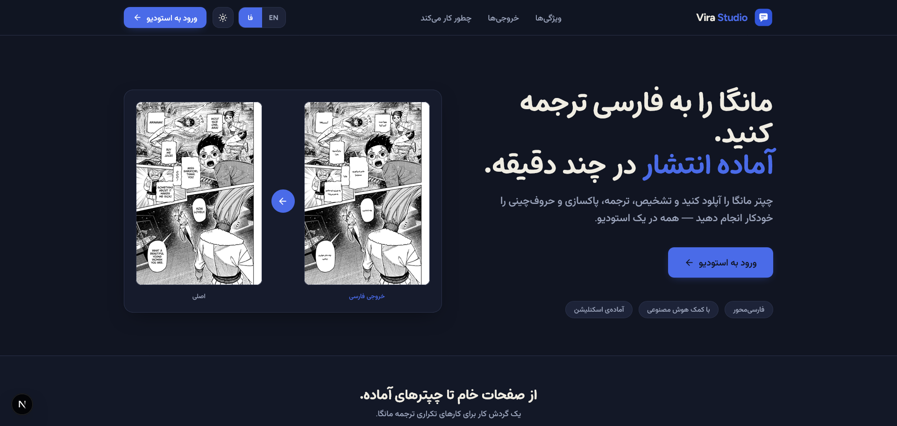
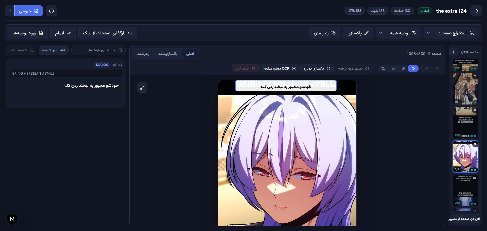

<div align="center">

# 📘 MWW Translator Studio

**A complete studio for translating manhwa, manga & comics into Persian — runs on your own machine, private and unlimited.**

You feed it a PDF: text gets detected, translated to Persian, the original is inpainted away, and the Persian text is rendered on the page. Export: **PDF / ZIP / PSD**.

[](LICENSE)
[](https://www.python.org/)
[](https://nodejs.org/)
[](https://www.djangoproject.com/)
[](https://nextjs.org/)

**[🇮🇷 راهنمای فارسی / Persian Guide](README.md)**



<sub>⬆ The project landing page — real screenshot goes here.</sub>

</div>

---

## 🤖 What is it?

A full-stack, local-first studio for Persian manga/manhwa translation:

1. 📥 Upload an untranslated PDF
2. 🔍 Every speech-bubble text is auto-detected (OCR)
3. 🌐 Texts are machine-translated (with an API key) or you type translations by hand
4. 🎨 The English text is inpainted away and the Persian text is rendered in its place
5. 📤 Final export with proper Persian fonts: **PDF, ZIP and PSD**

> 💡 Your images and data stay **on your own machine** (SQLite + local storage); external APIs are used only for machine translation (optional).



<sub>⬆ The studio editor — move boxes, type Persian translations, style each bubble.</sub>

## ✨ Features

- 🖼 **Visual editor**: drag & move boxes, resize from corners, double-click a bubble to type the Persian translation
- 🇮🇷 **Full RTL UI**: Persian/English switcher, dark/light theme, Mikhak & Vazir fonts
- 🧠 **Multiple translation providers**: OpenRouter, Gemini, and Custom (any OpenAI-compatible endpoint — even local ones like LM Studio or Ollama)
- 📊 **Live progress bar**: real-time logs for Extract, Translate and Apply jobs
- 📈 **Manhwa-aware OCR**: vertical scroll pages with cross-page merging
- 📦 **Multiple exports**: rendered PDF, WebP page ZIP, layered PSD
- 🖋 **Adjustable typography**: font, size, color, alignment, live preview per block
- ⚙️ **Settings page**: provider keys, models, OCR parameters, inpainting settings

## ⚙️ Prerequisites

| Need | Minimum | Where to get it |
| --- | --- | --- |
| 🐍 Python | **3.10 – 3.12** (paddlepaddle compatible) | [python.org](https://www.python.org/downloads/) |
| 🟢 Node.js | **18.18+** | [nodejs.org](https://nodejs.org/) |
| 📦 Git (or download ZIP) | — | [git-scm.com](https://git-scm.com/) |
| 🔑 Translation API key (optional) | — | [OpenRouter](https://openrouter.ai/) or [Gemini](https://aistudio.google.com/apikey) |
| 🗂 LaMa model (optional) | `pip install simple-lama-inpainting` | see below 👇 |

> 🪟 Windows, Linux and macOS are all supported; on Windows the included **start.bat** does everything.

## 🚀 Quick start: 0 to 100

### Option 1 — Windows, one click (easiest)

1. 📥 Get the project:
   ```powershell
   git clone https://github.com/ArshiaGalaxy/MWW_TranslatorStudio.git
   cd MWW_TranslatorStudio
   ```
   (or download and extract the ZIP from the Releases page)
2. 🔛 Double-click **`start.bat`**. On the very first run it automatically:
   - ✔ Creates the Python virtual environment and installs core packages
   - ✔ Creates the database (migrations)
   - ✔ Installs frontend packages (`npm install`)
   - ✔ Starts both servers and opens your default browser

> ⏱ First run takes 5–10 minutes (package downloads); later runs take seconds. Then create a desktop shortcut to the same file.

### Option 2 — Standard (Linux / macOS / your own terminal)

```bash
# 1️⃣ Get the code
git clone https://github.com/ArshiaGalaxy/MWW_TranslatorStudio.git
cd MWW_TranslatorStudio

# 2️⃣ Backend — Django + API (port 8000)
cd backend
python3 -m venv .venv
source .venv/bin/activate           # Windows:  .venv\Scripts\activate
pip install -r requirements-core.txt
python manage.py migrate
python manage.py runserver 127.0.0.1:8000

# 3️⃣ Frontend — Next.js (port 3000) in a new terminal
cd ../frontend
npm install
npm run dev
```

🌐 Open your browser at **http://localhost:3000** — no login needed, straight to the dashboard.

## 🎬 0 to 100: your first real translation

| Step | What happens |
| --- | --- |
| 1️⃣ Log in | `/login` with `admin / admin123` |
| 2️⃣ New project | Dashboard → drag & drop the PDF, pick **Manhwa** or **Manga**, create the project |
| 3️⃣ Extract | Hit **Extract OCR** — bubbles are detected as you go; un-tick covers/pages you don't want |
| 4️⃣ Studio | In the editor: move boxes, resize, **double-click = type the Persian translation**; right panel: font/size/color/alignment per block |
| 5️⃣ Auto-translate (optional) | **Auto-translate** for one page or all pages → machine translation via API |
| 6️⃣ Apply & Export | **Apply & Export** → originals inpainted away, Persian rendered → download links for **PDF / ZIP / PSD** |
| 7️⃣ Settings | The Settings page edits the global engine config: keys, models, OCR params, typography |

> 📌 The project also runs **without** the heavy AI packages: you can translate manually and still export PDF/ZIP/PSD. For auto-OCR and machine translation, one extra step is needed 👇

## 🤖 Enabling the AI features (optional)

**Tiered install:** so far only the light "Core" packages are installed. To unlock the AI features, install the full bundle once:

```powershell
cd backend
pip install -r requirements.txt
```

Then:

- 🔑 **Translation key** — either way works:
  - OS environment variable: `setx GEMINI_API_KEY "..."` or `setx OPENROUTER_API_KEY "sk-or-..."`
  - or inside the app: **Settings** → Translator section

  <sub>(If you set the env var just now, restart the Django backend so it gets picked up.)</sub>

- 🎨 **High-quality inpainting (optional)** — for better text removal with LaMa, just install this package into the venv (it is detected and used automatically):
  `pip install simple-lama-inpainting`

| Tier | What you get |
| --- | --- |
| 🧱 Core (default) | Server, login, manual editing, PDF/ZIP/PSD export |
| 🤖 Full (`requirements.txt`) | + auto-OCR, machine translation, inpainting |

## 🔑 Environment variables

| Variable | Default | Notes |
| --- | --- | --- |
| `OPENROUTER_API_KEY` | — | OpenRouter models |
| `GEMINI_API_KEY` | — | Google Gemini |
| `CUSTOM_BASE_URL` | — | Custom provider base URL (OpenAI-compatible) |
| `CUSTOM_API_KEY` | — | Custom provider API key (optional) |
| `DJANGO_DEBUG` | `1` | When `0`, you must also set `DJANGO_SECRET_KEY` |
| `DJANGO_SECRET_KEY` | — | Django secret (required for production) |
| `DJANGO_ALLOWED_HOSTS` | — | (optional) production domains |
| `BACKEND_URL` | `http://127.0.0.1:8000` | Frontend `/api` & `/media` proxy target |

## 🧯 Troubleshooting

| Problem | Fix |
| --- | --- |
| `Port 8000 already in use` | Close the previous server window, or on Windows: `netstat -ano \| findstr :8000` then `taskkill /PID <pid> /F` |
| Browser opened but page is blank/erroring | Backend is still booting — wait a few seconds and refresh |
| Extract button errors | Run `pip install -r requirements.txt` inside the venv — the OCR engine is a separate, heavier install |
| Auto-translate does nothing | Set the API key (above) and restart the backend |
| `DLL load failed` on paddleocr | Install 64-bit (x64) Python, not 32-bit |
| First page load is very slow | It's the first Next.js build — subsequent loads are fast |
| Images/files won't download | With `DJANGO_DEBUG=0`, `/media` files are served only to signed-in users — make sure you're logged in |

## 📜 License (please read)

Released under **[PolyForm Noncommercial 1.0.0](LICENSE)**:

- ✅ **Personal, noncommercial use is completely free** — download, run, modify, use on your own machine.
- ⛔ **Selling, republishing under a different name, or removing attribution is not allowed** — those require the author's written permission.
- 💌 For collaboration, commercial use or redistribution: [open an Issue](https://github.com/ArshiaGalaxy/MWW_TranslatorStudio/issues) or message me — happy to help.

## 🤝 Contributing

Contributions are welcome and simple — please read [CONTRIBUTING.md](CONTRIBUTING.md) first (it's short), open an Issue, and send a Pull Request once we've aligned.

---

<div align="center">

Built with ❤️ for the Persian-speaking community 🇮🇷

⭐ If this helps you, give the project a **Star** — it really motivates!

</div>
